# DeepSeek Android

一个面向 Android 的 DeepSeek 第三方客户端。它把 DeepSeek 官方开源的
[chat-demo](https://github.com/deepseek-ai/chat-demo) 的对话协议与移动端体验移植到
Jetpack Compose，并参考 [DeepSeek Harness](https://github.com/deepseek-ai/deepseek-harness)
的账号托管思路，实现了：

- 登录 DeepSeek 账号后**自动创建专用 API Key**；
- 用该 Key 直接聊天，无需手动复制粘贴；
- 查询账户余额；
- 一键打开官方充值页；
- 手动填写 API Key 的兼容模式；
- 导入官方网页/App 导出的历史对话 ZIP，并将本机对话导出为同格式 ZIP。

> 本项目不是 DeepSeek 官方客户端，与深度求索公司无隶属关系。请遵守 DeepSeek
> 开放平台的服务条款。账号托管部分依赖开放平台未公开的前端接口，接口可能随平台更新而变化；
> 应用始终保留“手动 API Key”作为回退方案。

## 下载

- GitHub 仓库：<https://github.com/Huanmeng692/DeepSeek-Android>
- Releases：<https://github.com/Huanmeng692/DeepSeek-Android/releases>
- 最新 Release 的签名 APK 请到 Releases 页面下载。

## 截图

| 登录 | 对话 | Markdown |
| --- | --- | --- |
| 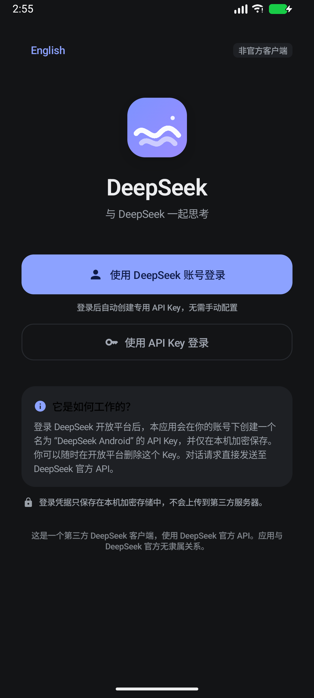 | 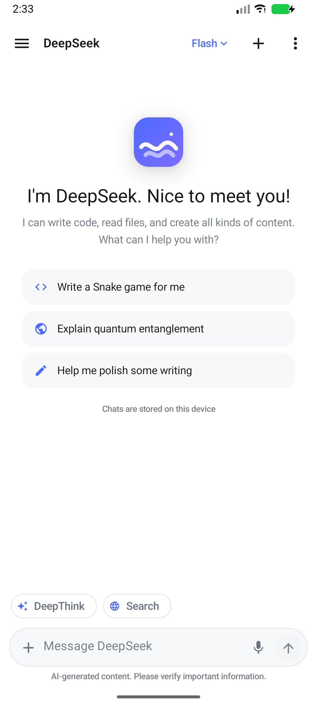 | 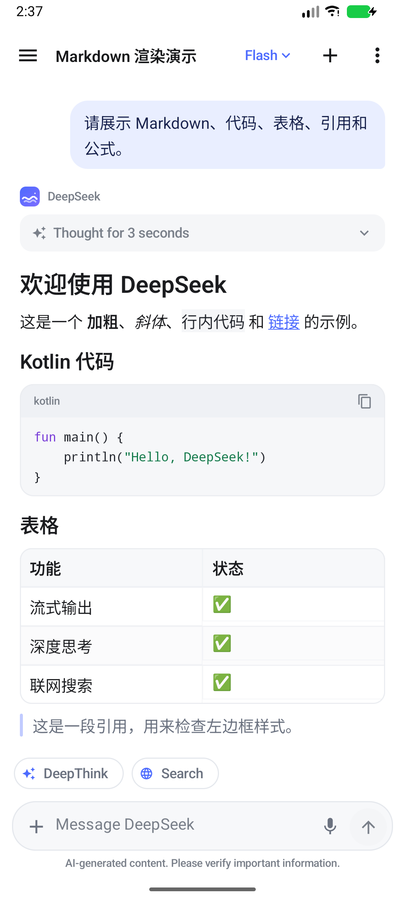 |

| 深度思考 | 联网来源 | 对话列表 |
| --- | --- | --- |
| 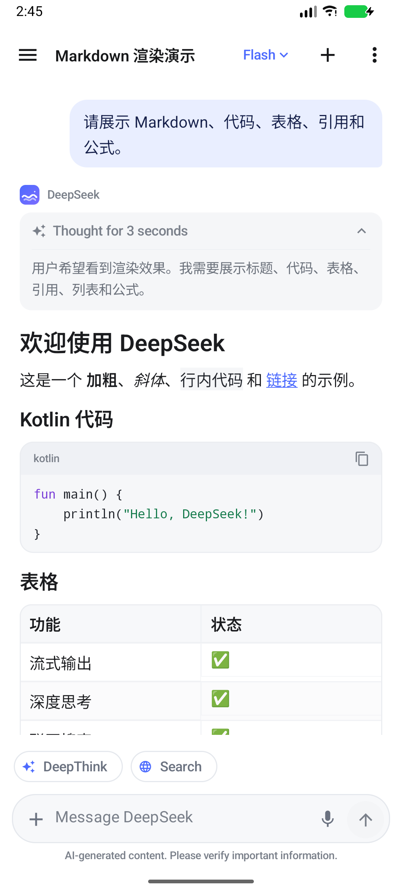 | 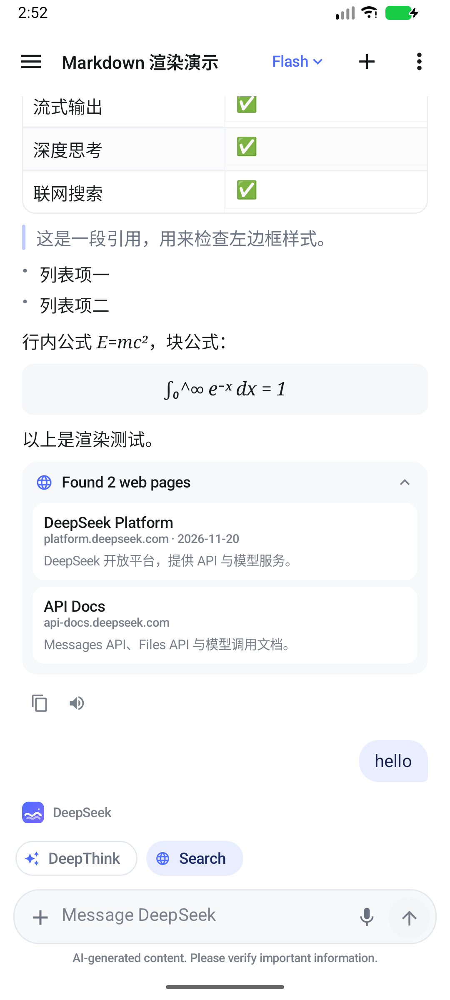 | 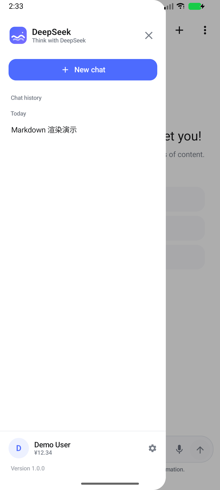 |

| 账号与余额 | 深色设置 | 平台登录 |
| --- | --- | --- |
| 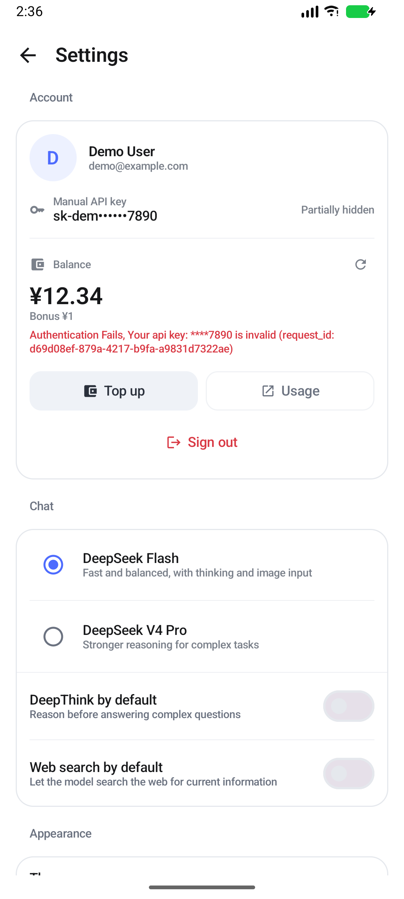 | 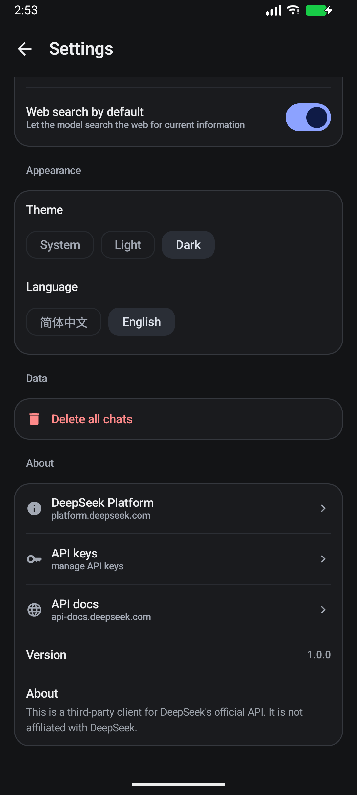 | 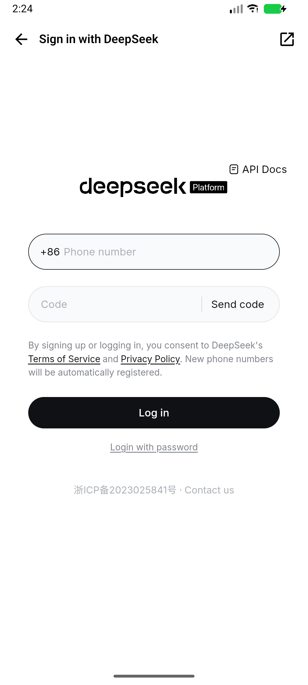 |

| 外观与语言 | 深色对话 | 启动图标 |
| --- | --- | --- |
| 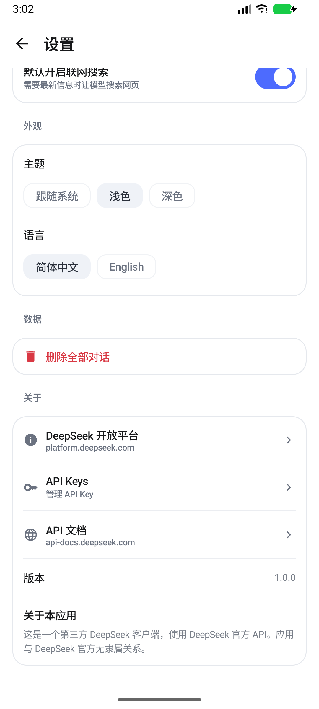 | 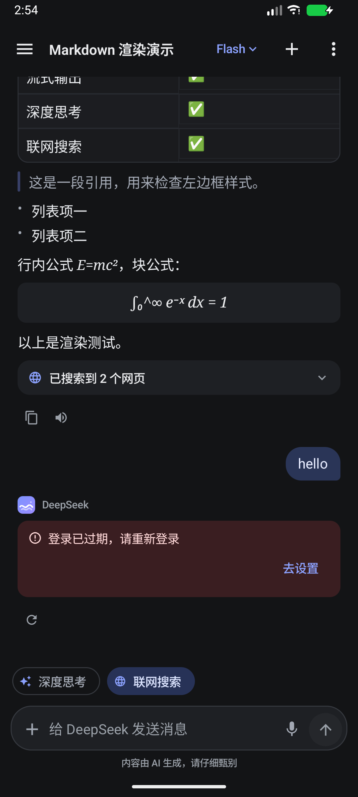 | 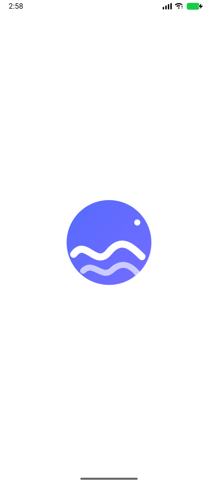 |

| 历史导入/导出 |
| --- |
| 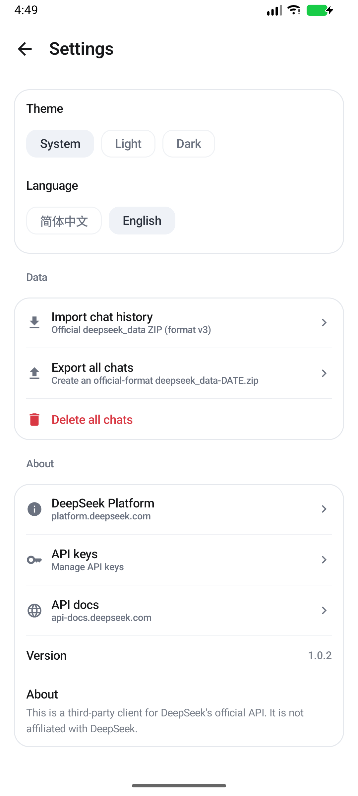 |

## 功能

### 对话

- 流式输出、停止生成、重新生成、自动生成标题；
- 深度思考（可折叠的思考过程与用时）；
- 联网搜索（服务端 `deepseek_web_search` 工具、搜索状态、来源卡片、引用链接）；
- 链接阅读（`deepseek_read_url`）；
- Markdown：标题、段落、粗体/斜体/删除线、行内代码、代码块（轻量语法高亮 + 复制）、
  引用、有序/无序列表、表格、分割线、行内/块级公式（LaTeX → Unicode）；
- 文件与图片附件：图片自动压缩，文档上传到 Files API 后以 `file_id` 引用；
- 语音输入（Android `SpeechRecognizer`）和朗读（Android `TextToSpeech`）；
- 多会话、重命名、删除、按时间分组的历史列表；
- 模型切换：`deepseek-flash` / `deepseek-v4-pro`；
- 浅色/深色/跟随系统主题；
- 简体中文 / English。

### 账号与额度

- WebView 登录 `platform.deepseek.com`；
- 自动读取登录态并在账号下创建名为 **DeepSeek Android** 的专用 API Key；
- 登录后自动验证 Key、读取余额；
- 账号卡片显示托管 Key（脱敏）、余额、赠金；
- “充值”打开 `platform.deepseek.com/top_up`，共享登录 Cookie；
- “用量”打开 `platform.deepseek.com/usage`；
- 退出登录时尝试删除托管 Key，并清除 WebView 登录数据；
- 手动 API Key 模式：验证 `GET /models` 后保存。

## 快速开始

### 环境

- Android Studio（支持 AGP 9.5 / SDK 37.2 的版本）
- JDK 21
- Android SDK Platform **37.2**（`compileSdk = 37.2`）
- 最低运行版本 Android 7.0（API 24）

项目使用 AGP 9 的内置 Kotlin（Kotlin 2.2.10）与 Compose 编译器插件，版本见
[`gradle/libs.versions.toml`](gradle/libs.versions.toml)。

### 构建

```bash
# Windows
gradlew.bat :app:assembleDebug

# macOS / Linux
./gradlew :app:assembleDebug
```

APK 输出：

```
app/build/outputs/apk/debug/app-debug.apk
```

安装到设备：

```bash
adb install -r app/build/outputs/apk/debug/app-debug.apk
```

> 部分国产 ROM（vivo/iQOO、部分小米/OPPO 等）默认关闭 USB 安装，或每次安装都会弹窗确认。
> 如果 `adb install` 报 `INSTALL_FAILED_ABORTED: User rejected permissions`，请在开发者选项中
> 打开“USB 安装 / 通过 USB 安装应用”，并在手机弹窗中点允许；也可以把 APK 复制到手机后手动安装。
> 使用相同签名的 Debug APK 覆盖安装会保留应用数据（账号、Key、聊天记录）。

发布构建：

```bash
gradlew.bat :app:assembleRelease
```

签名后的产物：

```text
app/build/outputs/apk/release/app-release.apk
```

### 签名材料

- `keystore/release.jks`：发布签名 keystore；
- `keystore/keystore.properties`：store/key 密码与 alias（**已加入 .gitignore，绝不提交**）；
- alias：`deepseek-android`；
- 证书 SHA-256：`FE:38:7B:28:3D:57:9C:C9:85:BF:0E:DB:E2:FB:16:61:60:48:95:CD:58:CC:E0:1B:48:6A:7C:BE:9B:FF:70:E1`。

请立即把整个 `keystore/` 目录备份到安全位置。**如果 `release.jks` 丢失，后续版本将无法覆盖安装或更新
已发布的 Release APK**。该目录不会进入 Git。

> 发布签名与 Debug 签名不同。如果你的手机当前安装的是 Debug APK，要切换到 Release APK 需要先卸载
> Debug 版（会清除本机聊天记录和加密凭据）；之后登录账号即可重新创建 Key。若没有 `keystore.properties`，
> `assembleRelease` 会退回生成未签名 APK，便于其他开发者构建。

### 历史导入/导出

设置 → 数据：

- **导入对话历史**：支持官方网页版/新版 App 导出的 `deepseek_data-日期.zip`
  （`export_format_version: 3`）。导入会合并到本机，同 ID 会话会更新，不删除其他对话。
- **导出全部对话**：生成同格式的 `deepseek_data-日期.zip`，包含会话、消息树和本地存在的图片原件。
- 导入按 `current_message_id` 还原当前分支；本应用是线性会话，因此其他分支不会保留。
- 思考、正文、搜索来源、打开网页、阅读链接、图片和文件元数据会尽量保留；未知片段
  （TIP、CONTENT_RISK、TOOL_IMAGE_SEARCH 等）会丢弃。
- 非图片附件只有元数据；缺失原件的图片显示为“仅记录，未包含原件”，不会参与后续上传。
- 归档不包含 API Key、账号、设置或登录信息。
- 该格式与 chat-demo / DeepSeek Harness 的官方历史导入格式一致；官方 App/网页当前是否能直接
  “导入”取决于官方版本，官方导出格式本身已兼容。

### 首次使用

1. 打开应用，选择 **使用 DeepSeek 账号登录**。
2. 在 WebView 中完成开放平台登录（手机验证码、密码或平台支持的方式）。
3. 返回应用，等待“验证账号 → 创建专用 API Key → 验证 Key → 读取余额”完成。
4. 开始对话。之后可在抽屉底部进入设置，查看余额、充值、切换主题/语言。

如果平台登录不可用，也可以选择 **使用 API Key 登录**，在
[开放平台 API Keys](https://platform.deepseek.com/api_keys) 创建 Key 后粘贴。

## 账号托管是怎么实现的

> 以下流程来自对开放平台 Web 前端行为的实现与适配。它不是 DeepSeek 公开文档中的
> OAuth 接口，属于**非公开接口**，仅用于个人账号在本机使用。

1. **WebView 登录**：`https://platform.deepseek.com/sign_in`。
2. **读取登录态**：轮询页面 `localStorage.userToken`（兼容 `{value, __version}`
   包装），同时读取 `platform.deepseek.com` 的 Cookie。
3. **验证账号**：`GET https://platform.deepseek.com/auth-api/v0/users/current`
   （`Authorization: Bearer <token>` + Cookie + 客户端标识头）。
4. **创建专用 Key**：

   ```http
   POST https://platform.deepseek.com/api/v0/users/edit_api_keys
   Content-Type: application/json

   {
     "action": "create",
     "name": "DeepSeek Android",
     "redacted_key": null,
     "created_at": null,
     "tracking_id": null
   }
   ```

   响应中的 `biz_data.api_key.sensitive_id` 即一次性返回的完整 Key。

5. **验证 Key**：`GET https://api.deepseek.com/models`，失败会自动重试一次（新 Key
   偶尔需要短暂传播）。
6. **保存**：平台 Token、Cookie、API Key 和 Key 元数据全部用 Android Keystore
   AES-GCM 加密后保存在本机。
7. **余额**：`GET /api/v0/users/get_user_summary`；平台登录态失效时回退到
   `GET https://api.deepseek.com/user/balance`。
8. **退出登录**：先尝试通过 `get_api_keys` 找到对应的托管 Key 并删除，再清除加密数据
   与 WebView Cookie/localStorage。

### 关于“App-managed”标记

DeepSeek 平台截图中的 **App-managed** / “由 Harness 管理”是平台给 DeepSeek Harness
专用 Key 类型（`key_type = DSH`）的特殊展示。第三方应用无法、也不应该伪造这一类型。

本应用创建的是账号下一个**普通的专用 Key**，名称为 `DeepSeek Android`；应用内用
“应用托管 / App-managed”徽章标识“由本应用创建和管理”。两者的实际效果一致：一个只给
本应用使用的 Key，退出时可删除。

## 安全与隐私

- API Key、平台 Token、平台 Cookie 使用 **Android Keystore + AES/GCM** 加密；
  SharedPreferences 中只有密文和 IV。
- `android:allowBackup="false"`，避免云备份带走凭据。
- 关闭明文网络：`android:usesCleartextTraffic="false"`。
- 没有自建服务器、没有遥测、没有广告 SDK；对话直接发送到 `api.deepseek.com`。
- 聊天记录保存在本机 SQLite（会话 JSON）中；附件复制到应用私有目录。
- 退出登录会清除凭据和 WebView 登录数据；聊天记录按设计保留，可在设置中删除全部对话。
- WebView 登录页由 DeepSeek 官方页面承载；请确认你信任该页面及其第三方登录方式。

## 技术栈与结构

- Kotlin + Jetpack Compose + Material 3
- 单 Activity + 状态驱动 UI（`AppViewModel`）
- OkHttp（SSE 流式解析、Files API multipart）
- SQLiteOpenHelper（单表会话 JSON 存储，无 Room/KSP）
- Android Keystore（AES/GCM）
- Android `SpeechRecognizer` / `TextToSpeech`
- WebView（平台登录、充值、用量、链接阅读）

```
app/src/main/java/cn/drdream/deepseek_accountlogin/
├── MainActivity.kt              # 根 UI、登录结果、全局对话框/提示
├── DeepSeekApp.kt               # Application + 手动依赖容器
├── api/
│   ├── ApiModels.kt             # 流事件、余额、账户、托管 Key
│   └── DeepSeekApi.kt           # Messages SSE、Files、余额、平台账号接口
├── data/
│   ├── AccountManager.kt        # 登录、托管 Key、余额、退出
│   ├── AttachmentStore.kt       # 附件导入/图片压缩
│   ├── ChatDatabase.kt          # SQLite 会话存储
│   ├── ChatRepository.kt        # 内存状态 + 持久化
│   ├── JsonCodec.kt             # 会话/消息/内容块 JSON
│   ├── SecureStore.kt           # Keystore 加密存储
│   ├── SettingsStore.kt         # 主题/语言/默认开关/模型
│   └── model/Models.kt          # 数据模型
├── ui/
│   ├── AppViewModel.kt          # 发送、SSE 合并、标题、附件、重生成
│   ├── account/                 # 平台登录 Activity
│   ├── components/              # 消息、输入框、抽屉、对话框、附件
│   ├── markdown/                # 解析器、LaTeX、代码高亮、渲染
│   ├── screens/                 # 登录/对话/设置
│   ├── speech/                  # TTS
│   ├── theme/                   # 颜色、字体、形状
│   └── web/                     # WebView Host、充值页
├── res/                         # 品牌图标、主题、颜色
└── test/ androidTest/           # 单元测试 + UI 种子测试
```

## 对话协议

客户端使用 DeepSeek 的 Anthropic 兼容 Messages API（与 chat-demo 一致）：

```http
POST https://api.deepseek.com/anthropic/v1/messages
x-api-key: <API Key>
Accept: text/event-stream

{
  "model": "deepseek-flash",
  "system": "该助手为DeepSeek，由深度求索公司创造。",
  "messages": [...],
  "thinking": { "type": "enabled" },
  "tools": [
    { "type": "deepseek_read_url", "name": "deepseek_read_url" },
    { "type": "deepseek_web_search", "name": "deepseek_web_search" }
  ],
  "safety_check": { "level": "high" },
  "title": { "enabled": true },
  "stream": true
}
```

- 流事件：`message_start` / `content_block_start` / `content_block_delta` /
  `content_block_stop` / `message_delta` / `message_stop`；
- 内容块：`text`、`thinking`、`server_tool_use`、`web_search_tool_result`、
  `web_fetch_tool_result`；
- 附件：`POST /anthropic/v1/files`，图片带
  `anthropic-beta: files-api-2025-04-14`，请求中用 `image` / `document` +
  `{type:"file", file_id}` 引用；
- 自动标题：首轮请求带 `title.enabled`，从 `message_delta.delta.title` 读取；
- 上下文只回传有正文的“提问 + 回答”轮次，不发送历史思考块，加入
  `latest_reminder` 快照；这些行为与 chat-demo 保持一致。

## 测试

```bash
# Markdown 解析 + LaTeX 单元测试
gradlew.bat :app:testDebugUnitTest

# 需要已连接设备/模拟器
gradlew.bat :app:connectedDebugAndroidTest
```

`SeedUiTest` 会写入一个演示账号（假 Key）和一条覆盖 Markdown/表格/思考/来源的会话，
用于人工验证 UI；不会进入正式 APK。

已在 Android 17（API 37）模拟器上验证：

- 登录页、平台 WebView 加载；
- 手动 API Key 校验失败路径（展示平台原始 401 错误）；
- 平台 Token 注入 → 轮询 → 返回应用 → 平台接口 401 → 错误对话框；
- 欢迎页、对话、Markdown/代码/表格/公式、思考展开、来源展开；
- 链接点击打开 WebView；
- 发送消息的错误卡片与自动滚动；
- 设置、余额展示、深色主题、中文/English 切换、退出登录；
- 启动图标/启动画面；
- Debug 与 Release（R8 + lintVital）构建。

> 出于账号与费用安全考虑，自动化测试没有使用真实 DeepSeek 账号执行“创建托管 Key /
> 真实对话”的计费路径；这条链路已按开放平台前端接口实现，建议首次登录后先在设置中确认
> 余额和 Key 状态。

## 更新记录

### 1.0.2

- 新增官方历史对话 ZIP 导入/导出（`export_format_version: 3`）：
  - 设置 → 数据 → 导入对话历史 / 导出全部对话；
  - 兼容官方网页版/App 导出格式，以及 chat-demo / DeepSeek Harness 的导入格式；
  - 支持图片原件、文件元数据、思考、搜索来源、打开网页、阅读链接和当前分支；
  - 使用系统文件选择器，不需要存储权限；归档不包含账号、Key 或设置。
- 新增真实官方样例的导入→导出→再导入往返测试（测试夹具不提交）。

### 1.0.1

- 修复平台登录 WebView 中手机号/验证码输入时光标跳到开头、数字倒序的问题：
  关闭 WebView 自动填充，并在登录页注入光标修复脚本（仅作用于 `tel`/数字输入框）。
- 移除 WebView 的自定义 UA 后缀，避免平台按非标准浏览器处理。
- 修复对话请求中 `latest_reminder` 的平台字段：由 `Android` 改为 API 允许的 `App`，
  解决 “unknown platform 'Android'” 的 400 报错。

### 1.0.0

- 首个完整版本。

## 已知限制

- **账号托管依赖非公开接口**，平台改版后可能失效；此时请使用手动 API Key。
- WebView 登录可能遇到平台风控、验证码或第三方登录窗口；应用已开启 Cookie/DOM
  Storage，但无法保证所有登录方式都可用。
- “App-managed”是平台专用 Key 类型的展示；本应用创建的是普通专用 Key（应用内标记为托管）。
- 未实现 chat-demo 的消息分支切换、历史 ZIP 导入/导出、Mermaid 渲染、完整 KaTeX；
  公式使用 Unicode 近似，复杂公式可能不完美。
- 语音输入/朗读使用系统能力，不依赖 DeepSeek 服务端 ASR/TTS；设备没有对应引擎时会提示不可用。
- 同一时间只支持一个账号、一个生成中的回复；切换会话不会中断后台生成。
- 充值/支付页面在 WebView 中完成；如果支付渠道要求外部 App，可用右上角“在浏览器中打开”。
- 未做无障碍深度适配、平板双栏布局、通知/后台任务。

## 许可与致谢

本仓库代码采用 MIT License，见 [LICENSE](LICENSE)。

- 对话协议与交互参考：[deepseek-ai/chat-demo](https://github.com/deepseek-ai/chat-demo)（MIT）。
- 账号托管与“专用 Key”思路参考：[deepseek-ai/deepseek-harness](https://github.com/deepseek-ai/deepseek-harness)（MIT）。
- DeepSeek、DeepSeek 标识归深度求索公司所有；本项目仅用于个人学习与自用。

如果这个项目对你有帮助，欢迎在遵守 DeepSeek 服务条款的前提下使用和修改。
